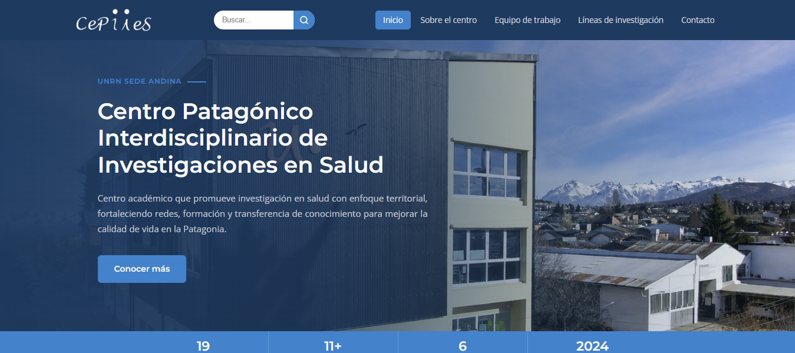
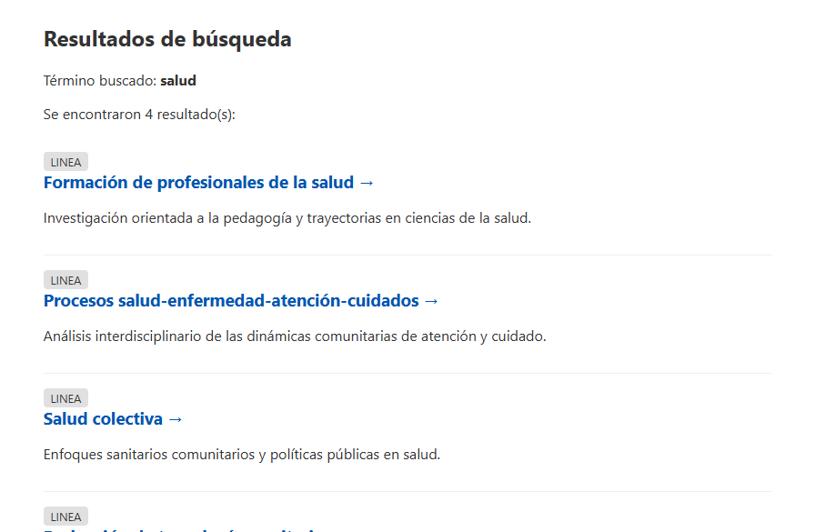
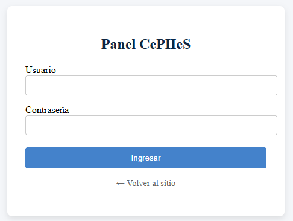
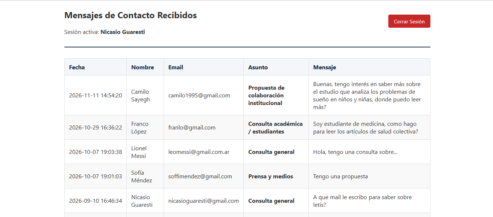
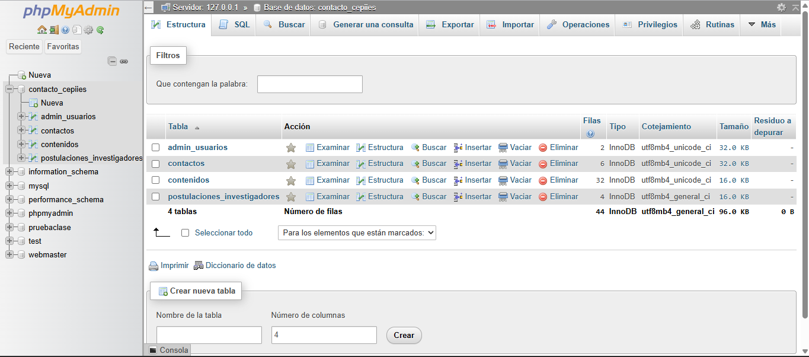
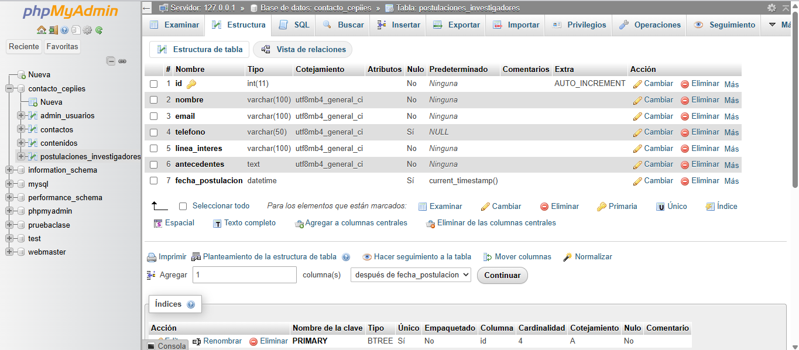

# Sitio Web Dinámico - CePIIeS (UNRN)

**Materia:** Producción Digital II – Cátedra Varela Coletta (Universidad de Palermo)  
**Alumno:** Nicasio Guaresti  
**Año:** 2026 – 2do Cuatrimestre  

Plataforma web institucional desarrollada en **HTML5, CSS3, PHP (PDO y Sesiones) y MySQL** para el Centro Patagónico Interdisciplinario de Investigaciones en Salud (CePIIeS - UNRN Sede Andina).

---

## 🧭 Guía de Navegación por las Vistas

El sitio cuenta con una barra de navegación superior fija que permite recorrer todas las secciones del centro y realizar búsquedas en tiempo real:

* **Inicio (`index.php`):** Presentación institucional, novedades, vinculaciones, sección LETIS/Laboratorio y formulario de contacto general.
* **Sobre el centro (`pages/sobreelcentro.html`):** Historia, misión, objetivos y estructura institucional del centro.
* **Equipo de trabajo (`pages/equipo.php`):** Nómina completa de docentes e investigadores y formulario público de postulación.
* **Líneas de investigación (`pages/lineas.html`):** Detalle de las áreas de trabajo y las 6 líneas principales de investigación.
* **Buscador Dinámico (`buscar.php`):** Integrado en el *header* de todas las vistas. Envía consultas mediante el método `GET` (`buscar.php?q=termino`), consulta la tabla `contenidos` mediante `LIKE` y redirige al usuario mediante anclas (`#id`) al bloque exacto de la página correspondiente.

---

## 📝 Envío de Formularios (Persistencia en MySQL)

El sistema cuenta con dos formularios públicos procesados del lado del servidor mediante PHP y conexiones seguras **PDO**:

1. **Formulario de Contacto (`index.php` → `procesar_contacto.php`):**
   * Ubicado al pie de la página principal.
   * El usuario completa *Nombre, Email, Asunto (desplegable) y Mensaje*.
   * Los datos se envían vía `POST`, se validan y se almacenan en la tabla `contactos` junto con la fecha y hora automática (`CURRENT_TIMESTAMP`).
2. **Formulario de Postulación de Investigadores (`pages/equipo.php`):**
   * Ubicado debajo del listado del equipo de trabajo.
   * Permite a profesionales externos postularse ingresando *Nombre, Email, Teléfono, Línea de interés y Experiencia académica*.
   * Los datos se envían vía `POST` y se registran en la tabla `postulaciones_investigadores`.

---

## 🔐 Acceso a la Zona Segura (Uso de Sesiones)

Para proteger los mensajes recibidos y evitar accesos no autorizados, el panel de administración funciona mediante variables de sesión de PHP (`$_SESSION`):

1. **Ingreso (`login.php`):** Se accede desde el enlace discreto *"Acceso Institucional (Admin)"* ubicado en el pie de página (`footer`).
2. **Validación:** Al enviar el formulario vía `POST`, PHP verifica el usuario y la contraseña contra la tabla `admin_usuarios` en MySQL. Si coinciden, se ejecuta `session_start()` y se define `$_SESSION['admin_logueado'] = true`.
3. **Protección de Ruta (`admin.php`):** Al inicio del archivo se comprueba si existe la sesión activa. Si un usuario intenta ingresar escribiendo la URL directamente sin loguearse, el servidor lo redirige automáticamente a `login.php`.
4. **Cierre de Sesión (`logout.php`):** Al presionar *"Cerrar Sesión"*, se ejecutan `session_unset()` y `session_destroy()` para eliminar los datos de la sesión del servidor.

**Credenciales de prueba para evaluación:**
* **Usuario:** `nguare` | **Contraseña:** `cepi123`
* **Usuario:** `admin` | **Contraseña:** `cepiies2026`

---

## 📸 Capturas de Pantalla

### 1. Navegación del Sitio y Buscador

### 2. Zona Segura (Login y Panel de Administración)

### 3. Estructura de la Base de Datos (`contacto_cepiies` en phpMyAdmin)

